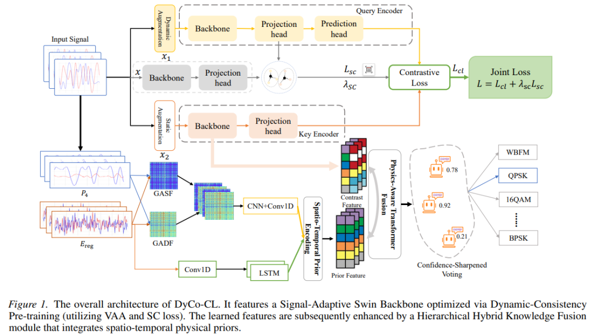
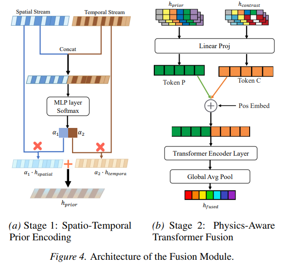
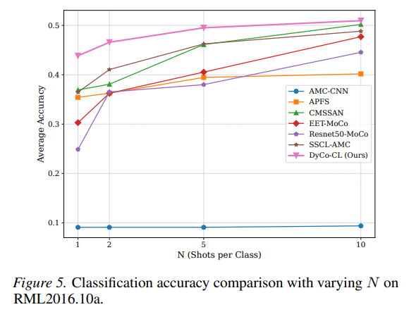
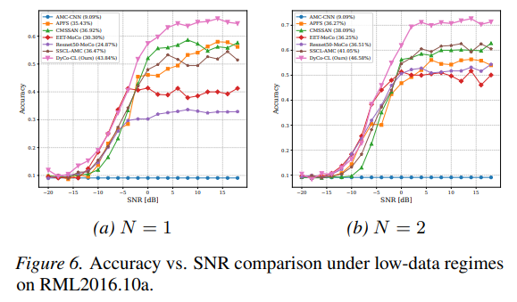
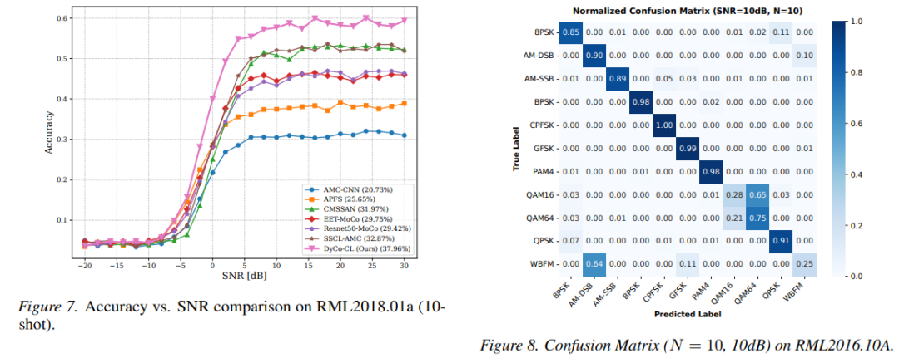
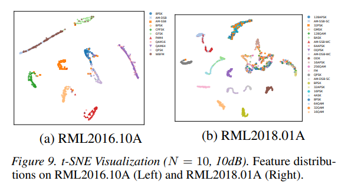

# [Modulation Identification] Geometric Perception Comparative Learning: A New Paradigm for Autonomous Modulation Identification with Small Samples [Attached Python Code]

Geometry Perception Contrastive Learning: A Novel Paradigm for Autonomous Modulation Recognition with Small Samples
Article Information: Thesis Title: Geometry Perception Contrastive Learning for Autonomous Modulation Recognition with Small Samples
I. Abstract: When applying traditional self-supervised learning (SSL) to autonomous modulation recognition (AMR), there are three major challenges: aggregation failure, attention spectrum instability, and semantic drift. This paper proposes the DyCo-CL dynamic consistency contrastive learning framework, which combines virtual adversarial enhancement (VAA) with semantic consistency loss. Theoretically, this strategy can serve as an implicit regularizer for the encoder's latent spectrum, achieving stable exploration in manifold spaces.
It also designs an adaptive signal Swin backbone network, enhancing locality of attention through fixed window constraints and improving structural stability; coupled with a hybrid knowledge fusion module, it utilizes communication physical priors to anchor feature representations.
Extensive experiments on the RML benchmark dataset show that under 1-shot small sample scenarios, DyCo-CL achieves an accuracy improvement of 6.27% compared to existing methods, while also featuring lightweight and low latency advantages, meeting the requirements of cognitive radio's low-labeled and real-time deployment in 6G networks.
II. Introduction: Autonomous Modulation Recognition (AMR) is the cornerstone of cognitive radio and the core technology for dynamic spectrum access in 6G networks.
Deep learning has replaced traditional expert features and likelihood inference methods, becoming the mainstream solution for AMR due to its strong representation capabilities. However, it heavily relies on large-scale labeled datasets, which are scarce and difficult to implement in non-cooperative communication scenarios.
To address the issue of data scarcity, self-supervised contrastive learning has been introduced into radio frequency signal processing, relying on random data augmentation to learn invariant features. Some studies further incorporate physical priors and lightweight attention mechanisms to enhance robustness.
However, current methods face three major geometric limitations that severely constrain the performance of small sample AMR: ✅ Enhanced geometric challenges: The concentration effect of high-dimensional space measures leads to isotropic noise perturbations being almost orthogonal to the decision boundary gradient, making them ineffective; unconstrained transformations easily cross class boundaries, leading to semantic drift. ✅ Self-Attention Spectrum Instability: The Lipschitz constant of standard Transformer self-attention is unbounded, resulting in a sharp decision boundary that is extremely fragile to anisotropic perturbations. ✅ Static knowledge fusion inefficacious: Current methods simply concatenate physical priors with deep features as static auxiliary inputs, treating physical priors as static auxiliary inputs and unable to correct feature drift as semantic anchors, resulting in catastrophic performance in extreme 1-shot scenarios.
In response to the above pain points, this paper proposes a geometric perception-based DyCo-CL semi-supervised framework. It models from three dimensions: optimization strategy, network architecture, and physical prior fusion, to construct a novel self-supervised scheme suitable for small sample AMR.
III. Methodology and Theoretical Core🔥 The overall framework of DyCo-CL consists of three core modules that are closed loops, each regulating and enhancing the others:
1  
Dynamic Consistency Framework: Virtual Adversarial Augmentation (VAA) + Semantic Consistency Loss, Solving the High-Dimensional Measure Concentration Problem;
2  
Signal Adaptive Swin Backbone Network: Convolutional Embedding + One-Dimensional Fixed Window Swin Encoder, constraining spectral instability from the structural perspective.
3  
Hierarchical Knowledge Fusion Module: Spatiotemporal Physical Prior Coding + Perception Transformer Fusion, anchoring features and suppressing semantic drift.
1. Analysis of the Challenges in High-Dimensional Signal Geometry Theory (1) In isotropic noise, Gaussian random perturbations are statistically nearly orthogonal to the model's sensitive gradient directions, only producing invariance along safe tangential directions, creating a false sense of robustness: models can tolerate high-energy noise but are extremely vulnerable in critically sensitive directions.
1. Semantic drift risk: Without constraints, geometric enhancement can easily cross the margin of modulation signal classes (e.g., QPSK constellation points rotated to adjacent quarters), and physical labels have changed, but the contrast loss still enforces alignment of sample features, introducing noise gradients and distorting the signal manifold structure.
2. Transformer spectral instability: The Lipschitz constant of standard pointwise attention with self-attention in the transformer spectrum grows unboundedly with sequence length, naturally generating sharp decision boundaries that cannot withstand anisotropic perturbations required for measurement concentration.
2. Dynamic consistency contrastive learning strategy:
(1) Asymmetrical enhancement design weak enhancement branch: Using communication domain physical transformations (random phase rotation, IQ flip, time shift, noisy, frequency offset, amplitude scaling), simulating real channel damage, and strictly constraining the magnitude of transformations to avoid cross-class drift;
Adversarial enhancement branch: Virtual adversarial enhancement VAA, quantifying model output distribution sensitivity through KL divergence, solving for the optimal perturbation direction within a finite perturbation radius, accurately hitting the model's most sensitive gradient direction, solving the problem of random enhancement failure.
(2) Semantic consistency regularization loss: Designing a semantic consistency loss that constrains the adversarial sample features within the local neighborhood of the original sample features, stopping gradient fixed semantic centroid, offsetting the feature drift caused by VAA, implicitly minimizing the encoder's local Lipschitz constant, compacting class-specific features, and stabilizing output boundaries.
(3) Total loss function combines contrastive loss with semantic consistency loss, balancing representation diversity and semantic fidelity:
3. Signal adaptive Swin backbone network deep convolutional embedding: Three layers of one-dimensional convolution build learnable low-pass filters to suppress high-frequency noise, while soft tokenization retains IQ signal phase continuity;
One-dimensional fixed window Swin encoder: Divides the signal sequence into fixed non-overlapping windows for local self-attention, with Jacobian matrix structured as block diagonal, and only determined by the window size, decoupled from sequence length, fundamentally solving spectral instability from the network structure.
4. The hierarchical hybrid knowledge fusion module integrates the prior knowledge of communication physics with the deep features of the model in two stages:
1  
Temporal-spatial Prior Coding: Extracting the physical features of four-order cyclic spectrum and PSD regular envelope, through spatial flow (GAF+2D CNN) and temporal flow (bidirectional LSTM), dual branch coding, and adaptive weighted fusion by a gating network.
2  
Physical Perception Transformer Fusion: Constructing a composite sequence by combining physical prior Tokens with model features Tokens, and dynamically calibrating the physical prior to deep features through self-attention, thereby correcting semantic drift.
3  
Confidence Sharpening Integrated: Multi-branch head secondary weighted prediction, suppresses small sample ambiguous classification noise, enhances generalization capability.
5. Theoretical proof of the core conclusion 1
Structure Spectrum Stability: The fixed window attention constrains the global Lipschitz constant to a bounded constant only dependent on the window size, thoroughly avoiding the unbounded instability issue of standard Transformer.
2  
Implicit Spectral Regularization: Minimizing the Semantic Consistency Loss, equivalent to minimizing the encoder's expected local Lipschitz constant, constraining model smoothness.
3  
Small sample generalization bound tightening: In small sample scenarios, the generalization error is dominated by a Lipschitz constant. DyCo-CL significantly reduces the upper bound of the generalization error through spectral regularization, ensuring transferability even with minimal annotations.
6. Experimental core results 1
Small-sample performance: RML2016.10a dataset, 1-shot scenario, DyCo-CL accuracy reaches 43.84%, surpassing the existing SOTA by 6.27%.
2  
Robustness to signal-to-noise ratio: The performance inflection point is earlier under low SNR, leading by 7.7% at 10dB compared to the baseline, and RML2018.01a maintains a stable lead of 7.54% in the high SNR range.
3  
Ablation Experiment: The three major modules of VAA, Swin backbone, and adaptive fusion are indispensable. Removing any module will lead to a significant performance drop.
4  
Deployment efficiency: With only 1.44M parameters, occupying 5.8MB storage space, the inference latency is 0.60ms. Compared to similar SOTA models, it reduces FLOPs by 2.5 times and improves throughput by 3 times, meeting the real-time edge deployment requirements of 5G/6G.
5  
Feature Visualization: t-SNE displays the model with tight intra-class compactness and clear inter-class boundaries, and the confusion matrix has a strong discriminatory power for PSK, QAM, etc.
IV. Conclusion This paper proposes the geometric perception contrastive learning framework DyCo-CL to address three major geometric challenges in small sample automatic modulation recognition: enhancing failure, attention spectrum instability, and semantic drift.
1  
Proposes a dynamic consistency strategy with VAA + semantic consistency loss to break the effect of high-dimensional measurement concentration, and also acts as an implicit spectral regularizer for the encoder.
2  
Design a signal adaptive one-dimensional Swin backbone to constrain the Lipschitz constant structurally by fixed window attention, achieving spectral stability.
3  
Construct a hierarchical physical knowledge fusion module, dynamically anchor features with communication priors to suppress small sample semantic drift.
Extensive benchmark experiments have demonstrated that DyCo-CL has set a new SOTA in the 1-shot extreme small sample scenario, featuring high recognition accuracy, strong robustness against signal-to-noise ratio, and lightweight and low latency advantages. It is well-suited for low-labeled real scenarios such as cognitive radio and non-cooperative communication in 6G.
Future research directions will focus on open-set modulation recognition, further expanding the model's generalization ability in scenarios involving unknown modulation types.
💡 The editor summarizes this ICML 2026 paper that breaks away from traditional AMR network design thinking, starting with the high-dimensional signal geometry characteristics. It deeply couples contrastive learning, Swin Transformer, and communication physical priors, conducting both theoretical geometric analysis and grounding a lightweight engineering model. This perfectly aligns with the application needs of 6G small sample and real-time spectrum perception, providing a new geometric perceptual design idea for autonomous radio signal learning.

## Images

<!-- PAYMENT_BLOCK -->

## Get this dataset

- Payment link (Stripe): [Buy now](https://buy.stripe.com/3cs8yP7sY87d0vu9AB)
- Payment QR code: 

<!-- /PAYMENT_BLOCK -->
